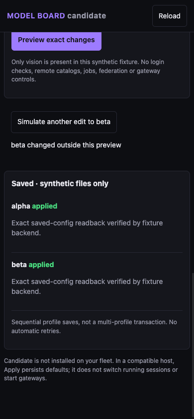

# Model Board

Phone-first bulk model settings for **Hermes Agent**, by **driptothebone**.

Filter profile names, select several profiles, and preview exact changes to main,
subagent/delegation and vision routes or reasoning effort before explicitly applying.
The model picker intersects the host-owned catalogs of the selected profiles.



## Install

Requires Hermes **0.23.0 or later**, its browser dashboard, the local-file config
backend and **in-process** plugin loading. Separate plugin-host isolation, remote
config and profile-scoped tickets are not supported; the plugin refuses them.
Do not weaken an existing isolation policy to enable this plugin.

```sh
hermes plugins install https://github.com/driptothebone/hermes-model-board
hermes plugins enable hermes-model-board
```

Open **Model Board** in the Hermes browser dashboard. No native Desktop app is
required. Use the dashboard's existing authenticated HTTPS/Tailscale access for
a phone; this plugin does not create an endpoint or expose a port.

## Safety and disclosures

- No `.env`, `auth.json`, Codex CLI login or other credential-store reads.
  Model choices come through Hermes's `/api/model/options` route. Hermes itself
  owns credential hydration and may refresh/probe provider catalogs.
- Reads host-authorized profile routing configuration through Hermes's config
  backend. It does not return whole configurations or credential/endpoint fields.
- Exact preview, explicit confirmation, expiring single-use preview tokens,
  stale-state rejection and saved-field readback. A main route change clears a
  stale context pin, visibly in the preview.
- Saves profiles sequentially under the actual host's same-process mutation lock.
  **Not a fleet transaction, rollback system or cross-process lock.** Partial or
  uncertain outcomes are reported per profile; no automatic Apply replay.
- Does not start/restart gateways, switch running chat sessions, launch models,
  execute shell commands, install dependencies, add telemetry, or self-update.
- Explicit endpoint/auth overrides and unsupported task-effort combinations are
  refused rather than silently changed. Invalid routing strings are withheld.
- First release UI covers main, delegation/subagents and vision. It does not
  include jobs, account-alias grouping, federation or every auxiliary task.

## Compatibility and verification

Exercised on Hermes v0.23.0 with synthetic profiles, actual core config writes,
automatic local-directory plugin discovery, served UI assets and authenticated
requests. Confirmation, unauthorized access and stale saves were checked.
The phone layout was exercised at 390 x 844; screenshots use **synthetic profiles**.
Actual offline host catalogs were empty: no claim of live account entitlement or
provider inference is made by the synthetic tests.

The local Hermes admission validator passes and its security scan reports safe.
**Private/config-backend API warnings remain**: the adapter reads the existing
host's auth guard and mutation lock and uses version-sensitive config-backend
functions. It never replaces or patches Hermes core. Review compatibility on
future Hermes releases; validation is not a promise of catalog acceptance.

## License

MIT. Copyright (c) 2026 driptothebone.
